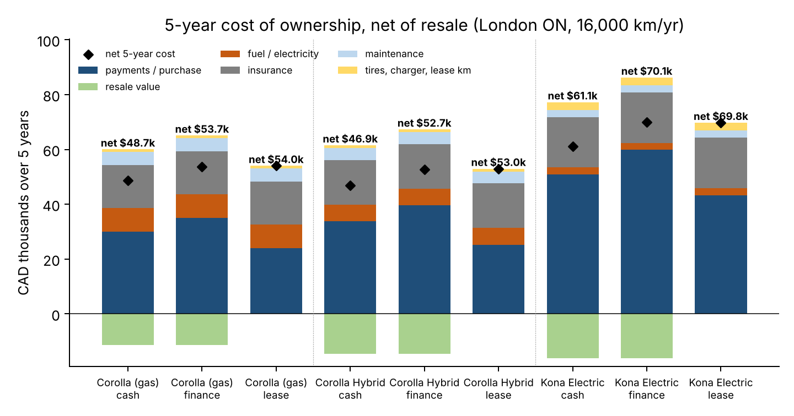
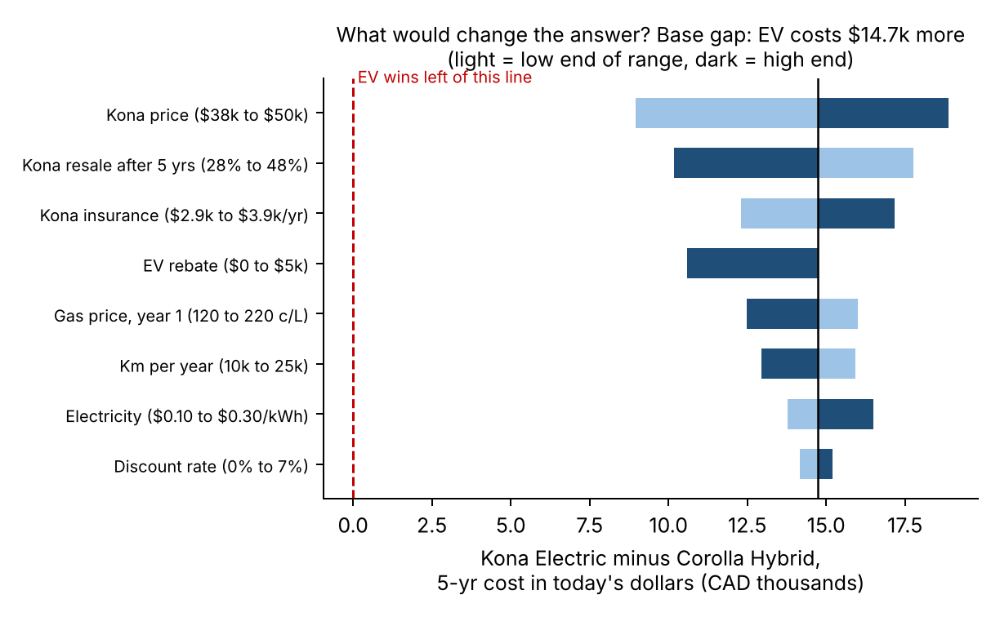
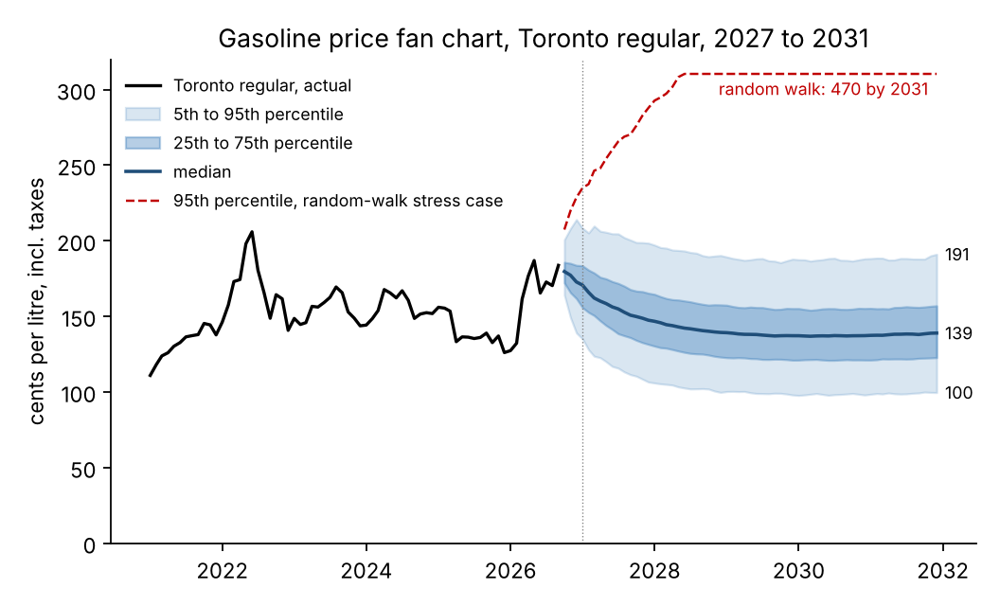
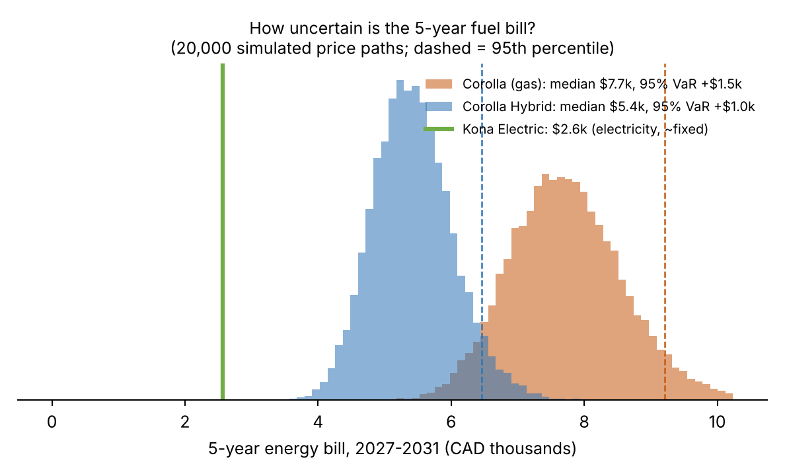

# Buy, lease or finance: a new grad's first car in London, Ontario

*Sami Slikko · November 2026 · Data: Statistics Canada, Bank of Canada, US EIA, NRCan, freMTPL2. Code, data and Excel model: repository `ontario-driving-cost`.*

**Recommendation.** I would buy a **2026 Toyota Corolla Hybrid**. Paying cash is cheapest (**\$46.9k** net over five years, after selling the car), but I won't have \$33.8k in cash after graduating. So I would **finance it over 60 months with as large a down payment as I can manage, and shop the loan rate hard**. Every 1 percentage point on the loan costs about **\$793** over five years. The gas Corolla costs \$1.0k more, and the Hyundai Kona Electric costs \$14.7k more, even though it has the cheapest and least risky "fuel".

**1. What five years of driving really costs.** At 16,000 km a year, the hybrid works out to about **\$878/month all-in** when financed. That covers the car, fuel, insurance, maintenance and winter tires, minus resale. Two surprises: **insurance (\$16.2k) costs more than fuel (\$6.1k)**, and paying cash beats financing only because I'd otherwise pay a 6.99% loan rate (the 2.50% Bank of Canada rate plus a lender spread), well above the 3.5% my savings would earn. Leasing and financing are nearly tied in today's dollars (\$48.2k vs \$48.8k). A lease charges HST only on the depreciation I use, but it caps mileage and leaves me owning nothing. A \$14.7k car at the end is worth the small difference.

{width=49%} {width=49%}

**2. Is the EV ever the better buy?** The tornado chart (right) moves each input across a realistic range. None of them closes the \$14.7k gap on its own. In today's dollars, the Kona only breaks even if its price falls to about **\$27.2k** (from \$45.0k), if gasoline averages **574 ¢/L** for five years, or if I drive **90k km a year**. What matters most is the EV's price and how fast it loses value, not fuel. A used or much cheaper EV is the case worth checking again.

**3. How exposed am I to fuel prices?** I simulated 20,000 five-year paths for the Toronto pump price (StatCan has no London series). The model separates out taxes, lets the market price drift back toward its 2015–26 average (half-life about 10 months), and replays real historical shocks. The median price in 2031 is **139 ¢/L**, with a 90% range of 100–191 ¢/L. For the hybrid, the 95% value-at-risk on five years of fuel is only **\$1,036** above the expected \$5,427, and the expected shortfall is \$1,357. For the gas Corolla it is \$1,478. A statistical test cannot rule out that prices follow a random walk instead (p = 0.51). In that case the 95th percentile for 2031 is **470 ¢/L** and the hybrid's VaR rises to \$5,058. A hybrid roughly halves that tail risk, and that makes it a cheap insurance policy.

{width=49%} {width=49%}

**4. Why pump prices behave the way they do.** Crude changes reach the pump fast: 87% of the effect shows up in the same month. Pump prices move 1.44 ¢/L for each 1 ¢/L move in crude, which is above the 1.13 ¢/L from crude plus HST because refining margins move with crude. I found no "rockets and feathers" in the direct response. The asymmetry is in **margins**: when they are fat, they shrink back slowly (half-life about 11 months), and when they are squeezed, they recover in about 1 month (p = 0.03). So after a crude price crash, expect pump prices to take most of a year to fully follow. Gasoline added +1.0 points to CPI inflation in 2022 and +0.5 points so far in 2026.

**5. What I'd tell a business.** For a 50-van delivery fleet, a minimum-variance hedge of about 2.5 RBOB gasoline futures contracts a year (hedge ratio 0.90) removes about **89% of fuel cost variance**, including on 2022–26 data the hedge was not fitted to. It cuts the worst 12-month budget overrun from \$94.8k to \$35.0k. The hedge needs cash to back it: in the 2022 spike and collapse, the margin account tied up as much as \$118k. For a small carrier with debt/EBITDA of 3.0x, a 30% fuel spike with no fuel surcharge pushes leverage to **5.8x**, breaching a 3.5x covenant. With no surcharge, a covenant breach takes only a **9%** fuel rise. The hedge should cover only the cost the surcharge does not pass on.

**6. Insurance, the biggest controllable cost.** Pricing models fitted on 678,000 French policies (claim frequency with a Poisson GLM, claim size with a Gamma GLM; test-set Gini 0.29) rank driving record and vehicle age as the strongest factors, followed by driver age. A 22-year-old with a new record prices at **2.6x** an experienced driver. Five clean years bring that down to 1.3x. Ontario insurers use the same structure, so the cheapest move is to protect my record and compare at least three quotes.

*Main assumptions (all changeable in `drivecost/tco.py` and `excel/tco_model.xlsx`): prices \$26.5k / \$29.9k / \$45.0k before tax; HST 13%; \$3,000 down; 60-month loan at policy rate + 4.49%; lease at policy rate + 3.49% with 20,000 km/yr; gas 156 ¢/L in year 1 (last 12 months' Toronto average), +2%/yr; electricity \$0.17/kWh blended; no EV rebate; insurance quotes are estimates. Not financial advice.*
