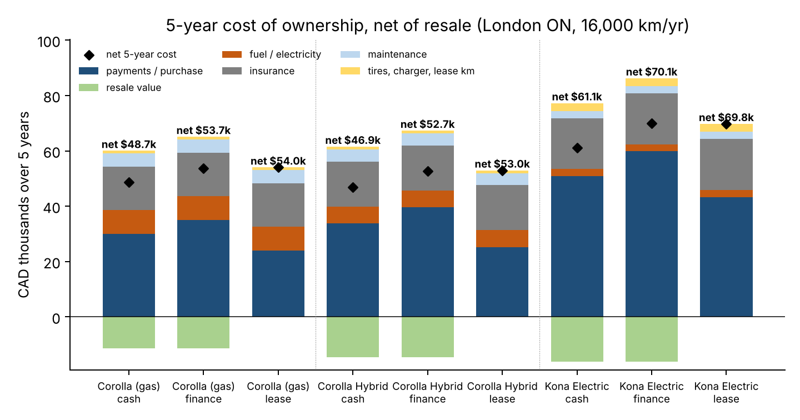
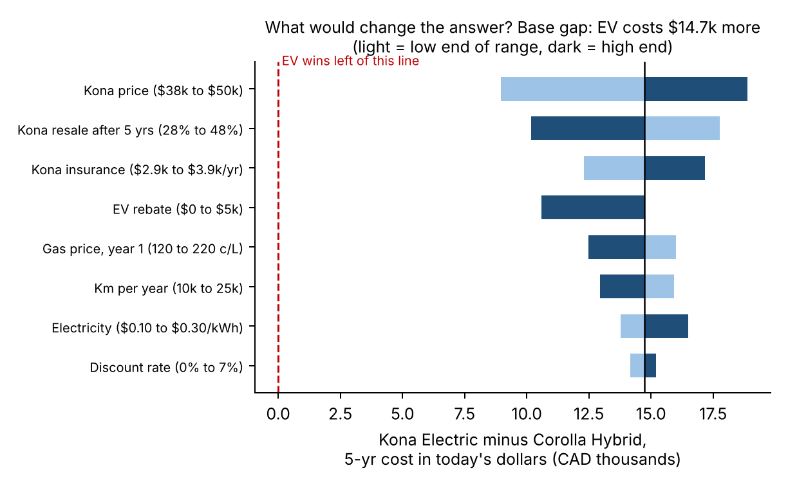
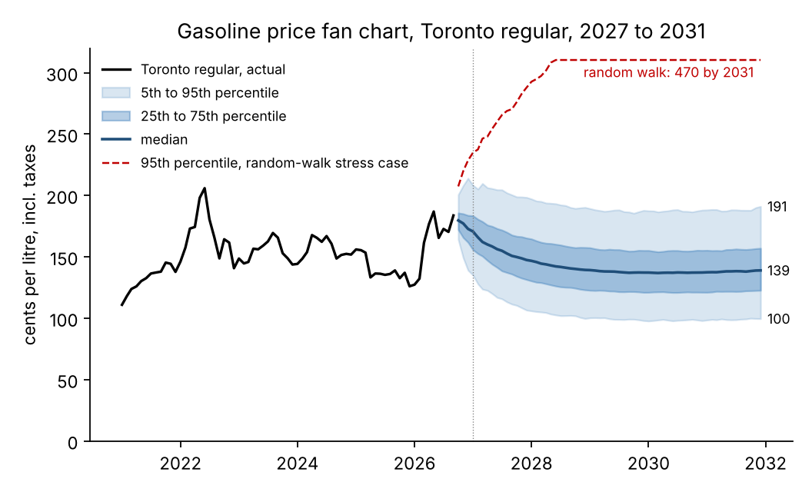
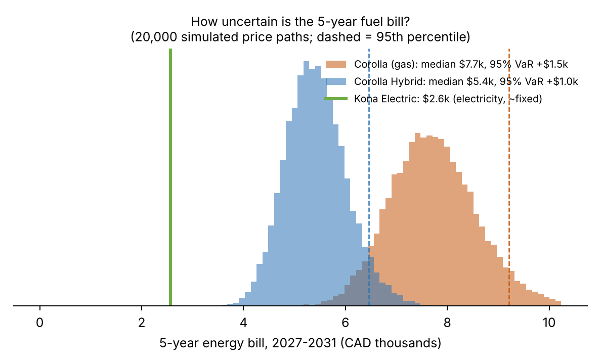

# Buy, lease or finance: a new grad's first car in London, Ontario

*Sami Slikko · {date} · Data: Statistics Canada, Bank of Canada, US EIA, NRCan, freMTPL2. Code, data and Excel model: repository `ontario-driving-cost`.*

**Recommendation.** I would buy a **2026 Toyota Corolla Hybrid**. Paying cash is cheapest (**\${hev_cash_k}k** net over five years, after selling the car), but I won't have \${hev_cash_upfront_k}k in cash after graduating. So I would **finance it over 60 months with as large a down payment as I can manage, and shop the loan rate hard**. Every 1 percentage point on the loan costs about **\${per_100bp}** over five years. The gas Corolla costs \${gas_vs_hev}k more, and the Hyundai Kona Electric costs \${ev_vs_hev}k more, even though it has the cheapest and least risky "fuel".

**1. What five years of driving really costs.** At 16,000 km a year, the hybrid works out to about **\${hev_fin_month}/month all-in** when financed. That covers the car, fuel, insurance, maintenance and winter tires, minus resale. Two surprises: **insurance (\${hev_ins_k}k) costs more than fuel (\${hev_fuel_k}k)**, and paying cash beats financing only because I'd otherwise pay a {loan_apr}% loan rate (the {policy}% Bank of Canada rate plus a lender spread), well above the {disc}% my savings would earn. Leasing and financing are nearly tied in today's dollars (\${hev_lease_npv_k}k vs \${hev_fin_npv_k}k). A lease charges HST only on the depreciation I use, but it caps mileage and leaves me owning nothing. A \${hev_resale_k}k car at the end is worth the small difference.

{{width=49%}} {{width=49%}}

**2. Is the EV ever the better buy?** The tornado chart (right) moves each input across a realistic range. None of them closes the \${base_gap_k}k gap on its own. In today's dollars, the Kona only breaks even if its price falls to about **\${ev_be_k}k** (from \${ev_price_k}k), if gasoline averages **{gas_be} ¢/L** for five years, or if I drive **{km_be}k km a year**. What matters most is the EV's price and how fast it loses value, not fuel. A used or much cheaper EV is the case worth checking again.

**3. How exposed am I to fuel prices?** I simulated 20,000 five-year paths for the Toronto pump price (StatCan has no London series). The model separates out taxes, lets the market price drift back toward its 2015–26 average (half-life about {half_life} months), and replays real historical shocks. The median price in 2031 is **{p50_2031} ¢/L**, with a 90% range of {p5_2031}–{p95_2031} ¢/L. For the hybrid, the 95% value-at-risk on five years of fuel is only **\${hev_var}** above the expected \${hev_mean}, and the expected shortfall is \${hev_es}. For the gas Corolla it is \${gas_var}. A statistical test cannot rule out that prices follow a random walk instead (p = {adf_p}). In that case the 95th percentile for 2031 is **{rw_p95_2031} ¢/L** and the hybrid's VaR rises to \${hev_var_rw}. A hybrid roughly halves that tail risk, and that makes it a cheap insurance policy.

{{width=49%}} {{width=49%}}

**4. Why pump prices behave the way they do.** Crude changes reach the pump fast: {first_month}% of the effect shows up in the same month. Pump prices move {pt_crude} ¢/L for each 1 ¢/L move in crude, which is above the 1.13 ¢/L from crude plus HST because refining margins move with crude. I found no "rockets and feathers" in the direct response. The asymmetry is in **margins**: when they are fat, they shrink back slowly (half-life about {hl_pos} months), and when they are squeezed, they recover in about {hl_neg} month (p = {ecm_p}). So after a crude price crash, expect pump prices to take most of a year to fully follow. Gasoline added {gas_cpi_2022} points to CPI inflation in 2022 and {gas_cpi_2026} points so far in 2026.

**5. What I'd tell a business.** For a 50-van delivery fleet, a minimum-variance hedge of about {contracts} RBOB gasoline futures contracts a year (hedge ratio {h}) removes about **{oos_vr}% of fuel cost variance**, including on 2022–26 data the hedge was not fitted to. It cuts the worst 12-month budget overrun from \${worst_u}k to \${worst_h}k. The hedge needs cash to back it: in the 2022 spike and collapse, the margin account tied up as much as \${margin_peak}k. For a small carrier with debt/EBITDA of 3.0x, a 30% fuel spike with no fuel surcharge pushes leverage to **{lev_30}x**, breaching a 3.5x covenant. With no surcharge, a covenant breach takes only a **{be_0}%** fuel rise. The hedge should cover only the cost the surcharge does not pass on.

**6. Insurance, the biggest controllable cost.** Pricing models fitted on 678,000 French policies (claim frequency with a Poisson GLM, claim size with a Gamma GLM; test-set Gini {gini}) rank driving record and vehicle age as the strongest factors, followed by driver age. A 22-year-old with a new record prices at **{young_x}x** an experienced driver. Five clean years bring that down to {clean_x}x. Ontario insurers use the same structure, so the cheapest move is to protect my record and compare at least three quotes.

*Main assumptions (all changeable in `drivecost/tco.py` and `excel/tco_model.xlsx`): prices \${gas_price_k}k / \${hev_price_k}k / \${ev_price_k}k before tax; HST 13%; \${down} down; 60-month loan at policy rate + 4.49%; lease at policy rate + 3.49% with 20,000 km/yr; gas {gas_cpl} ¢/L in year 1 (last 12 months' Toronto average), +2%/yr; electricity \${elec}/kWh blended; no EV rebate; insurance quotes are estimates. Not financial advice.*
